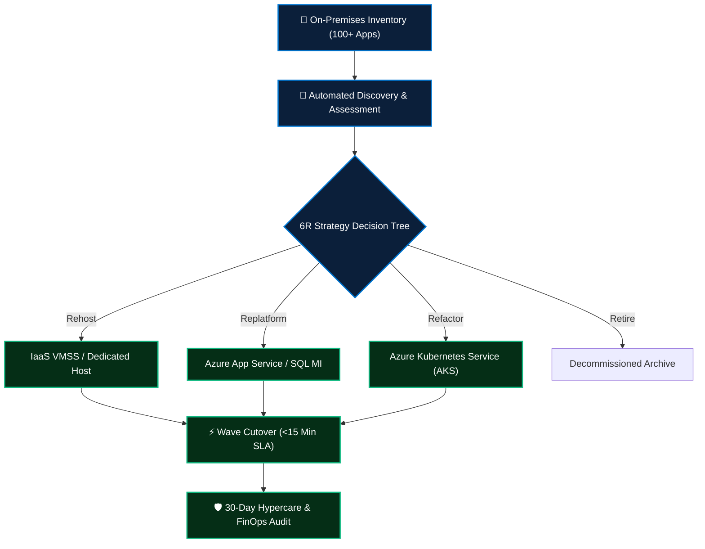

<div align="center">

# 🚚 Enterprise 100+ Application Cloud Migration Factory

[](#)
[](#)
[](#)
[](#)

**Production-grade migration framework, discovery toolkits, wave orchestration runbooks, and cutover protocols designed for mass enterprise cloud transitions.**

</div>

---

## 🎯 Scope & Strategic Objectives

Migrating 100+ mission-critical enterprise workloads spanning legacy on-premises datacenters, virtualized hypervisors, and distributed databases into Microsoft Azure requires disciplined execution:

- 🧭 **6R Decision Matrix:** Systematic workload classification across Rehost, Replatform, Refactor, Repurchase, Retain, and Retire.
- ⚡ **Automated Wave Discovery:** Script-driven inventory collection analyzing vCPU, RAM, storage IOPS, and network dependencies.
- ⏱️ **Sub-15 Minute Cutovers:** Database replication and live block-level sync ensuring zero data loss and minimal maintenance downtime.
- 🛡️ **Post-Migration Hypercare:** 30-day operational telemetry auditing, FinOps rightsizing, and formal handover to SRE operations.



---

## 📁 Repository Structure

```
.
├── framework/
│   └── 6r-decision-matrix.md      # Detailed 6R classification criteria
├── runbooks/
│   └── wave-migration-playbook.md # Pre-checklist, cutover window, and hypercare
├── scripts/
│   └── discovery-assessment.ps1   # Automated host & telemetry discovery script
└── README.md
```

---

## 👤 Author

**Sujeet Kumar**  
*Senior DevSecOps Engineer & Enterprise Cloud Architect (17+ Years Experience)*  
[](https://linkedin.com/in/sujeetkumar122)
[](https://github.com/Sujeetkumar122)
